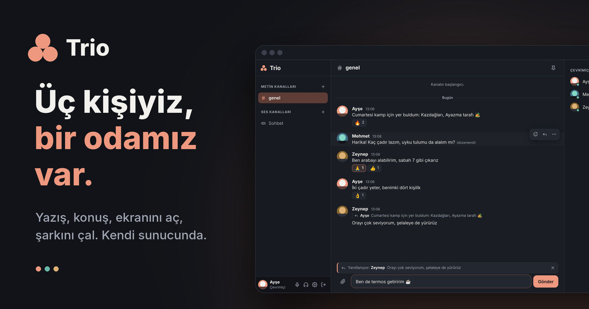

# Trio

Bir grubun kendi sohbeti, kendi sunucusunda: yazı kanalları, sesli odalar, ekran ve müzik paylaşımı, kamera, dosyalar. Bir arkadaş grubu, küçük bir ekip ya da küçük bir topluluk Trio'yu kendi sunucusuna kurar; içeri davet koduyla girilir, mesajlar ve dosyalar o sunucuda kalır. Tarayıcıdan, telefondan ya da masaüstü uygulamasından (Windows, macOS, Linux) kullanılır. Arayüz Türkçe.



**Kimin için, ne kadar büyük.** Trio küçük gruplar için yapıldı: bir sunucuda 10–15 kişiye kadar. Sesli odada herkes herkese doğrudan bağlanır (sunucu sesi taşımaz), bu yüzden bir sesli odaya en çok 8 kişi girer (sunucu sahibi `TRIO_VOICE_ROOM_MAX` ile 16'ya kadar açabilir); kamera ve ekran açıkken daha az kişiyle daha rahattır. Yüzlerce kişilik bir topluluk için uygun değil. Merkezî bir Trio hizmeti de yok: her grup kendi sunucusunu çalıştırır.

**Kurulum.** Gruptan bir kişi sunucuyu kurar. Önerilen yol **Railway** (tek servis, tek volume, komut satırı gerekmez, yaklaşık yarım saat); isteyen kendi VPS'inde Docker Compose + coturn ile çalıştırır. Adımlar: [Kendi sunucunu kur](#kendi-sunucunu-kur). Her sunucunun `/indir` sayfası Trio'yu tanıtır ve masaüstü uygulamasını indirtir.

## Özellikler

- Yazı kanalları: kalıcı geçmiş, yukarı doğru sonsuz kaydırma, "yazıyor" satırı, okunmamış işareti, tıklanabilir bağlantılar
- **Dosya ekleri**: ataç düğmesi, panodan yapıştırma, sürükle-bırak; görseller mesajın içinde (tıklayınca büyür), video/ses oynatıcıyla, diğer dosyalar indirilebilir satır olarak. Varsayılan sınır dosya başına 25 MB, mesaj başına 10 dosya
- Sesli odalar: sustur, sağırlaştır, konuşan kişi göstergesi
- **Kamera** ve ekran paylaşımı (sesiyle), tam ekran izleme
- **Bas-konuş (push-to-talk)**, tuşu ayarlardan seçilir; masaüstü uygulamasında pencere odakta değilken de çalışır
- **Gürültü bastırma** (RNNoise), ayarlardan açılıp kapanır
- Mikrofon / hoparlör / kamera seçimi (ayarlar penceresi)
- **Masaüstü uygulaması** (Windows, macOS, Linux; `desktop/`): sistem tepsisi, okunmamış rozeti, global bas-konuş tuşu
- Hesap yok, e-posta yok: ad + ortak davet kodu. Arayüz Türkçe

## Mimari

```
tarayıcı / masaüstü ──HTTPS/WSS──> Railway kenarı ──> app (FastAPI + SQLite, tek süreç)
tarayıcı <──── WebRTC (ses / kamera / ekran), doğrudan ya da Cloudflare TURN üzerinden ────> tarayıcı
```

- **app**: tek konteyner (kökteki `Dockerfile`). `/api/*` (REST), `/ws` (mesajlar, çevrimiçi durumu, WebRTC sinyalleşmesi) ve derlenmiş web istemcisini sunar. Veri: tek bir SQLite dosyası + yüklenen dosyalar, ikisi de `/data` volume'unda.
- **TURN**: iki kişi birbirine doğrudan ulaşamadığında (simetrik NAT, mobil şebeke) medyayı aktarır. Railway'de UDP olmadığı için TURN, Cloudflare'in ücretsiz TURN hizmetinden gelir; sunucu kısa ömürlü kimlik bilgilerini Cloudflare'den alıp istemciye verir.
- Sesli oda **tam ağ (mesh)**: herkes herkese doğrudan bağlanır, sunucu medyaya dokunmaz. Bir ses odasına varsayılan olarak en çok 8 kişi girer (`TRIO_VOICE_ROOM_MAX`, 2–16); kamera/ekran açıkken sınır daha erken gelir. Kalabalık bir grup birden fazla sesli oda kullanır.
- Uygulama **tek süreç** çalışır (durum bellekte). Birden fazla worker ya da replika çalıştırma.

Sözleşmeler: [`CONTRACT.md`](CONTRACT.md), [`CONTRACT-V2.md`](CONTRACT-V2.md), [`CONTRACT-V3.md`](CONTRACT-V3.md) (güvenlik sertleştirmesi, cihaz bağlama, yönetim aracı).

## Kendi sunucunu kur

Trio'yu gruptan bir kişi kurar; ilk giren hesap sunucunun **sahibi** olur (Ayarlar › Yönetim: kim bağlı, kim ne kadar yer kullanıyor, oturum kapatma, kişi çıkarma, yedek indirme). İki yol var: **Railway** (önerilen, her şey panelden) ya da [kendi VPS'in](#kendi-vpsinde-docker-compose).

Ne gerekir: Railway'de bir proje (planına göre ayda birkaç dolar) ya da Docker kurulu küçük bir Linux sunucu (1 vCPU / 1 GB yeter), verinin durduğu bir disk ve isteğe bağlı, ücretsiz bir Cloudflare TURN anahtarı.

### Railway'de (önerilen)

**1. Proje.** Bu depoyu GitHub'da kendi hesabına çatalla (**Fork**). Railway'de **New Project → Deploy from GitHub repo** ile depoyu seç. Railway kökteki `Dockerfile`'ı kendisi bulur ve imajı (web + sunucu) derler. `railway.json` yok ve gerekmiyor; ayarların hepsi panelden yapılır.

**2. Volume.** Servisin üzerinde sağ tık (ya da `Ctrl/⌘+K` → *Add Volume*) → **Volume ekle**, bağlama yolu (mount path) **`/data`**. Veritabanı `/data/trio.db`, yüklenen dosyalar `/data/uploads` altında durur; imaj bu yolları zaten varsayılan olarak kullanır. Volume olmazsa her deploy'da tüm veri silinir.

> Railway volume'u root kullanıcısına ait bağlar. Konteyner root olarak başlar, giriş betiği (`trio-entrypoint`) `/data`'yı yetkisiz `trio` kullanıcısına devreder ve sunucuyu o kullanıcıyla çalıştırır (kod ve web istemcisi sunucu tarafından değiştirilemez). `RAILWAY_RUN_UID` ayarlamana gerek yoktur; ayarlarsan betik hiçbir şeyi değiştirmeden o kullanıcıyla çalışır.

**3. Değişkenler.** Servis → **Variables**:

- `TRIO_INVITE_CODE` (zorunlu): grubuna vereceğin kod, ör. `openssl rand -hex 8`
- `TRIO_CF_TURN_KEY_ID` ve `TRIO_CF_TURN_API_TOKEN`: Cloudflare TURN (aşağıya bak). Olmadan da çalışır, ama farklı ağlardaki kişiler birbirini duyamayabilir.
- `TRIO_MAX_USERS`: **gerçek kişi sayısına ayarla** (ör. on iki kişilik bir grupsanız `12`). Varsayılan 15; davet kodu sızarsa yabancılar ancak boş kalan yerleri doldurabilir.
- İsteğe bağlı: `TRIO_MAX_UPLOAD_MB`, `TRIO_USER_QUOTA_MB`, `TRIO_DISK_RESERVE_MB`, `TRIO_TRUSTED_PROXY_HOPS` (tablo aşağıda)

`PORT`'u Railway kendisi verir, sunucu onu dinler; elle ayarlama.

**Cloudflare TURN anahtarı.** Ücretsiz bir Cloudflare hesabıyla: panelde **Realtime → TURN Server** bölümüne gir, **Create** ile yeni bir TURN anahtarı oluştur, bir ad ver. Gösterilen **Turn Token ID** değerini `TRIO_CF_TURN_KEY_ID`'ye, **API Token** değerini `TRIO_CF_TURN_API_TOKEN`'a yaz. API token yalnızca bir kez gösterilir; kaybedersen yeni anahtar oluştur. (Panelde menü adları zaman zaman değişiyor; eski adı "Calls".)

**4. Sağlık kontrolü.** Servis → **Settings → Deploy → Healthcheck Path**: **`/api/health`**. Railway yeni sürümü bu adres 200 dönünce devreye alır.

**5. Alan adı.** Servis → **Settings → Networking → Generate Domain**. `https://<ad>.up.railway.app` gibi bir adres çıkar (port sorulursa: Railway'in verdiği `PORT`, yani panelin önerdiği değer). İstersen burada kendi alan adını da bağlayabilirsin. HTTPS'i Railway sağlar.

**6. Dene.** Adresi aç, ad + davet kodu ile gir: ilk giren sensin, sunucunun sahibi de sen olursun. Mikrofon izni ver, sesli odaya katıl. Sonra adresi ve kodu grubuna gönder; davet bağlantısı (`https://<ad>.up.railway.app/#davet=<kod>`) kodu kendiliğinden doldurur.

**Güncelleme:** çatalını GitHub'da güncelle (**Sync fork**) ya da kendi deponda push et; Railway yeniden derler ve deploy eder. Veriler volume'da kalır. Deploy sırasında birkaç saniyelik kesinti olur (volume'lu servis tek kopya çalışır); istemciler kendiliğinden yeniden bağlanır, sesli odadakiler odaya geri girer.

## Grubun nasıl katılır

- **Tarayıcı:** Railway adresini açarlar, bir **ad** ve **davet kodunu** yazarlar. Oturum tarayıcıda saklanır. Telefonda da çalışır.
- **Masaüstü uygulaması:** `desktop/` içindeki uygulamayı kurarlar (GitHub Releases'teki Windows/macOS/Linux paketleri). İlk açılışta sunucu adresi sorulur: `https://<ad>.up.railway.app`. Sonra aynı giriş ekranı gelir. En kolayı sunucunun **`/indir`** sayfası (`https://<ad>.up.railway.app/indir`, girişsiz açılır): sistemi tanır, doğru dosyayı, SHA-256'sını ve uyarı çıkarsa ne yapılacağını gösterir. Paketler imzasız olduğu için Windows SmartScreen ve macOS Gatekeeper uyarı verir; imzalamak için `docs/imzalama.md`.

Kod sızarsa Railway'de `TRIO_INVITE_CODE`'u değiştir (servis yeniden başlar); mevcut oturumlar etkilenmez, yeni katılımlar yeni kodu ister. `TRIO_MAX_USERS` hesap sayısını sınırlar. İçeri girmiş bir yabancıyı ya da kaybolan bir telefonu aşağıdaki **Yönetim** aracıyla çıkarırsın.

**İkinci cihaz.** Aynı hesapla telefondan ve bilgisayardan girmek için davet koduyla ikinci kez katılma (bu yeni bir hesap açar ve bir yer harcar). Bunun yerine giriş yapılmış cihazda bir **bağlama kodu** alınır (10 dakika geçerli, tek kullanımlık) ve yeni cihazda girilir. Web arayüzündeki düğmesi ayrıca eklenecek; şimdilik kod yönetim aracıyla da üretilebilir (`new-link-code`, aşağıda).

## Ortam değişkenleri

| değişken | varsayılan | anlamı |
|---|---|---|
| `TRIO_INVITE_CODE` | (zorunlu) | ortak davet kodu; yoksa sunucu başlamaz |
| `TRIO_MAX_USERS` | `15` | bu sayıdan sonra yeni katılım reddedilir; gerçek kişi sayısına ayarla. Kaldırılan kullanıcılar sayılmaz |
| `TRIO_VOICE_ROOM_MAX` | `8` | bir ses odasında aynı anda en çok kaç kişi olabilir (2–16); dolu odaya katılım `ROOM_FULL` ile reddedilir |
| `TRIO_MAX_UPLOAD_MB` | `25` | dosya başına en büyük boyut (MB) |
| `TRIO_USER_QUOTA_MB` | `1024` | bir kullanıcının toplam yükleyebileceği (mesajda olsun olmasın) MB |
| `TRIO_DISK_RESERVE_MB` | `200` | diskte hep boş kalacak MB; bunun altına inecek yükleme `507` ile reddedilir |
| `TRIO_TRUSTED_PROXY_HOPS` | `1` | önündeki ters vekil (proxy) sayısı: istemci adresi `X-Forwarded-For`'un sağdan N'inci girdisi. Railway ve Caddy için `1`; uygulamaya doğrudan erişiliyorsa `0` |
| `TRIO_CF_TURN_KEY_ID` | boş | Cloudflare TURN anahtarının "Turn Token ID"si |
| `TRIO_CF_TURN_API_TOKEN` | boş | Cloudflare TURN anahtarının API token'ı (gizli) |
| `TRIO_TURN_HOST` | boş | kendi coturn sunucunun adı (VPS kurulumu; Cloudflare ayarlıysa kullanılmaz) |
| `TRIO_TURN_SECRET` | boş | coturn `static-auth-secret` (VPS kurulumu) |
| `TRIO_RELEASES_REPO` | `borankaraduman-star/Trio` | `/indir` sayfasının kurulum dosyalarını aldığı GitHub deposu (`sahip/ad`) |
| `TRIO_GITHUB_TOKEN` | boş | depo **özelse**: yalnız o depoda salt-okunur **Contents** izni olan ince ayarlı (fine-grained) token. Günlüğe ve yanıtlara asla yazılmaz |
| `TRIO_STUN_URLS` | `stun:stun.l.google.com:19302` | virgülle ayrılmış STUN adresleri |
| `TRIO_DB_PATH` | imajda `/data/trio.db` | SQLite dosyası |
| `TRIO_UPLOAD_DIR` | imajda `/data/uploads` | yüklenen dosyaların klasörü |
| `TRIO_STATIC_DIR` | imajda `/app/static` | derlenmiş web istemcisi |
| `PORT` | `8000` | dinlenen port; Railway kendisi verir |

TURN önceliği: Cloudflare (iki değişken de doluysa) → coturn (`TRIO_TURN_HOST` + `TRIO_TURN_SECRET`) → yalnızca STUN. Cloudflare'e ulaşılamazsa `/api/ice` hata vermez, yalnızca STUN döner ve sunucu günlüğüne bir uyarı yazar (token asla yazılmaz). Cloudflare'in yanıtı 1 saat önbellekte tutulur.

## Yönetim

Kullanıcıları listelemek, birini çıkarmak, oturumları kapatmak ve bağlama kodu üretmek için sunucuyla birlikte gelen araç:

```bash
python -m trio_server.admin list-users              # herkes: durum, oturum sayısı, kullandığı alan
python -m trio_server.admin revoke-tokens Ayşe      # Ayşe'nin bütün cihazlarındaki oturumu kapat (hesap kalır)
python -m trio_server.admin new-link-code Ayşe      # Ayşe için tek kullanımlık bağlama kodu (10 dk)
python -m trio_server.admin remove-user Yabancı     # hesabı kaldır
```

- Ad, katılırken olduğu gibi büyük/küçük harf duyarsız eşleşir; `#3` gibi bir kimlik numarası da yazılabilir (`list-users` gösterir).
- **`remove-user`**: kişinin oturumları kapanır ve bir daha giremez, yeri ve adı boşalır. **Mesajları silinmez**, eski adıyla görünmeye devam eder. Aynı adla sonradan biri katılırsa o yeni (başka kimlikli) bir hesaptır; eski mesajlarla aynı adı taşır. Kaldırma geri alınamaz.
- Telefonunu kaybeden biri: önce `revoke-tokens` (kaybolan cihaz dahil her yerden çıkış), sonra `new-link-code` ile yeni cihaza kod.
- Araç doğrudan SQLite dosyasıyla (`TRIO_DB_PATH`) çalışır; çalışan sunucuyu durdurmak gerekmez. Sunucu değişikliği yeni isteklerde ve bağlantılarda **hemen**, açık bağlantılarda **en geç 30 saniye** içinde fark eder (açık soketlerin belirteçlerini 30 saniyede bir yeniden denetler ve iptal edilenleri kapatır).
- Root olarak çalıştırılırsa veritabanı dosyasının sahibine (`trio`) geçer; böylece sunucunun yazamayacağı dosyalar bırakmaz.

**Railway'de:** araç, volume'un bağlı olduğu konteynerin **içinde** çalışmalı. Railway CLI ile servise bağlan ve komutu orada çalıştır:

```bash
railway ssh                                  # servisin konteynerine kabuk açar
python -m trio_server.admin list-users       # konteynerin içinde
```

Bu komutun tam biçimi (ör. proje/servis seçimi, `railway ssh -- python -m trio_server.admin list-users` gibi tek satırlık kullanım) burada **denenmedi**; Railway CLI belgelerine bak. `railway run` **işe yaramaz**: komutu senin bilgisayarında, servisin değişkenleriyle çalıştırır ve volume'daki veritabanına ulaşamaz.

**Docker / VPS'te:**

```bash
sudo docker compose exec app python -m trio_server.admin list-users        # deploy/ içinde
docker exec <konteyner> python -m trio_server.admin remove-user Yabancı     # tek docker run ile
```

## Yedekleme

Her şey volume'da: `/data/trio.db` (SQLite) ve `/data/uploads/` (dosyalar, adları rastgele kimlikler).

- **Railway yedekleri:** volume'un **Backups** sekmesinden elle ya da zamanlanmış yedek alınabilir (planına bağlı) ve geri yüklenebilir. En kolay yol budur.
- **Elle kopya:** Railway CLI ile servise bağlanıp (`railway ssh`) tutarlı bir veritabanı kopyası al:

  ```bash
  python -c "import sqlite3; s=sqlite3.connect('/data/trio.db'); d=sqlite3.connect('/data/yedek.db'); s.backup(d); d.close()"
  tar czf /data/yedek.tgz -C /data yedek.db uploads
  ```

  Ardından dosyayı makinene al (ör. `railway ssh` oturumunda `base64 /data/yedek.tgz` çıktısını kopyalayarak ya da kendi yönteminle) ve işin bitince `/data/yedek.*` dosyalarını sil.

Geri yüklemede `trio.db` ile `uploads/` birlikte geri konmalı; birinin eski diğerinin yeni olması, mesajlarda kırık eklere yol açar.

## Kendi VPS'inde: Docker Compose

Kendi sunucunu kurmanın ikinci yolu (yukarıdaki "Yönetim" ve "Yedekleme" burada da geçerli). Railway yerine tek bir Linux sunucuda (1 vCPU / 1 GB yeter) çalıştırmak için `deploy/` klasörü: Caddy (otomatik HTTPS), app (aynı kök `Dockerfile`) ve coturn (kendi TURN sunucun).

1. Alan adı için sunucunun IPv4'üne bir **A kaydı** aç.
2. Docker kur: `curl -fsSL https://get.docker.com | sudo sh`
3. Güvenlik duvarında aç: 80/443 tcp (443/udp isteğe bağlı), 3478 tcp+udp, 49160–49200 udp. Sağlayıcının kendi güvenlik duvarında da.
4. `cd deploy && cp .env.example .env`, değerleri doldur (`TRIO_DOMAIN`, `TRIO_PUBLIC_IP`, `TRIO_INVITE_CODE`, `TRIO_TURN_SECRET`; NAT arkasındaki sunucuda `TRIO_PUBLIC_IP=GENEL/ÖZEL`).
5. `sudo docker compose up -d --build`, sonra `sudo docker compose ps` (app `healthy` olmalı).

Güncelleme: `git pull && sudo docker compose up -d --build`. Yedek: `sudo docker compose exec app python -c "..."` ile yukarıdaki SQLite kopyası, artı `/data/uploads`. coturn'ün TLS'siz çalıştığı ve `turns:` adresinin bu yüzden başarısız olmasının beklendiği `deploy/turnserver.conf` içinde açıklanıyor. VPS'te de Cloudflare TURN kullanmak istersen `.env`'e iki `TRIO_CF_*` değişkenini yazman yeter; coturn'ün önüne geçer.

## Yerelde geliştirme

Python 3.12+, [uv](https://docs.astral.sh/uv/), Node 22.

```bash
cd server && uv venv && uv pip install -e '.[dev]'
TRIO_INVITE_CODE=gizli .venv/bin/python -m trio_server --reload --port 8000
.venv/bin/python -m pytest -q && .venv/bin/ruff check .

cd web && npm install && npm run dev      # http://localhost:5173, /api ve /ws :8000'e gider
```

`python -m trio_server` imajın kullandığı uvicorn ayarlarını (tek worker, websocket ileti sınırı, vekil başlıklarını uvicorn'a bırakmama) tek yerden uygular; doğrudan `uvicorn` çalıştırmak yerine onu kullan. `server/requirements.lock` imajın kurduğu sabitlenmiş (hash'li) bağımlılıklardır; `pyproject.toml`'daki bağımlılıkları değiştirince dosyanın başındaki komutla yeniden üret.

`localhost` güvenli bağlam sayıldığı için mikrofon HTTPS olmadan çalışır; ağdaki başka bir cihazdan IP ile açarsan çalışmaz. İmajı yerelde denemek: `docker build -t trio . && docker run -p 8000:8000 -e TRIO_INVITE_CODE=gizli -v trio_data:/data trio`.

## Sorun giderme

**"Ses yok" / bağlanıyor ama duyulmuyor**

1. Adres `https://` mi? Tarayıcılar mikrofon, kamera ve ekran paylaşımına yalnızca HTTPS'te (ve `localhost`'ta) izin verir. Railway adresi zaten HTTPS'tir.
2. Site için mikrofon izni verilmiş mi (adres çubuğundaki kilit simgesi)? macOS'ta *Sistem Ayarları → Gizlilik → Mikrofon/Kamera* içinde tarayıcıya (ya da Trio uygulamasına) izin var mı?
3. Ayarlar penceresinde doğru mikrofon ve hoparlör seçili mi? Giriş modu **bas-konuş** ise tuşa basmadan ses gitmez. Kişi kendini susturmuş/sağırlaştırmış olabilir.
4. Gürültü bastırmayı kapatıp dene (çok nadiren bazı mikrofonlarda sesi fazla keser).
5. Aynı evdekiler birbirini duyuyor ama dışarıdaki duymuyorsa sorun TURN'dedir:
   - Railway'de `TRIO_CF_TURN_KEY_ID` ve `TRIO_CF_TURN_API_TOKEN` dolu mu? Railway günlüğünde `ice.cloudflare.failed` uyarısı var mı (yanında HTTP durumu yazar; `401` = token yanlış)?
   - Giriş yapmışken tarayıcı konsolunda:

     ```js
     fetch('/api/ice', {headers: {Authorization: 'Bearer ' + localStorage.getItem('trio.token')}}).then(r => r.json()).then(console.log)
     ```

     Listede `turn:turn.cloudflare.com...` adresleri ve `username`/`credential` olmalı. Bu değerleri <https://webrtc.github.io/samples/src/content/peerconnection/trickle-ice/> sayfasında dene; **`relay`** türünde aday görmelisin.
6. `chrome://webrtc-internals` (Firefox: `about:webrtc`) seçilen aday çiftini ve paket sayaçlarını gösterir.

**Dosya yüklenmiyor.**

- "çok büyük" (`413 FILE_TOO_LARGE`) `TRIO_MAX_UPLOAD_MB` sınırıdır.
- `413 QUOTA_EXCEEDED`: kişinin toplam alanı (`TRIO_USER_QUOTA_MB`) doldu; `list-users` kimin ne kadar kullandığını gösterir. Dosya silme özelliği yok; gerekirse kotayı yükselt.
- `507 STORAGE_FULL`: volume dolmak üzere (`TRIO_DISK_RESERVE_MB` kadar boş yer korunur). Railway'de volume'u büyüt. Diğer her şey çalışmaya devam eder.
- `429 UPLOAD_IN_PROGRESS`: aynı kişi aynı anda yalnızca bir dosya yükleyebilir; dosyalar sırayla gönderilir.
- Railway'de volume `/data`'ya bağlı değilse dosyalar bir sonraki deploy'da kaybolur. 24 saat içinde bir mesaja eklenmeyen yüklemeler otomatik silinir (sunucu açılışında da).

**Sayfa açılıyor ama "bağlantı koptu".** Railway → Deployments → günlükler. `TRIO_INVITE_CODE` boşsa sunucu başlamaz. Sağlık kontrolü yolu `/api/health` olmalı.

**"Çok fazla deneme" (429).** Katılma denemeleri adres başına 10 dakikada 10 ile sınırlı. Ayrıca bütün istemciler için 10 dakikada toplam 30 **hatalı** deneme (yanlış davet ya da bağlama kodu) sınırı var; aşılırsa (biri kod deniyorsa) doğru kodla gelen kişi yine de en geç ~10 saniye içinde girebilir, `Retry-After` kaç saniye bekleneceğini söyler. Sürekli oluyorsa davet kodunu değiştir.

**Birçok sekme açıkken bağlantı kopuyor.** Bir kişi aynı anda en fazla 10 bağlantı (sekme/cihaz) açabilir; 11'inci `4429` koduyla kapatılır ve istemci yeniden dener. Fazla sekmeleri kapat; ölü bağlantılar ~40 saniyede düşer.

**Herkes çıkış yaptı / "oturum kapandı".** Biri `revoke-tokens` ya da `remove-user` çalıştırdıysa ilgili oturumlar 30 saniye içinde kapanır (`4401`); kişi yeniden katılır ya da bağlama kodu alır.

## Bilinen sınırlar

- Küçük gruplar için: bir sunucu 10–15 kişiye göre düşünüldü. Mesh nedeniyle bir sesli odaya en çok 8 kişi (`TRIO_VOICE_ROOM_MAX` ile 16'ya kadar); kamera ve ekran paylaşımı açıkken daha az kişiyle daha rahat.
- Tek süreç, tek kopya; yatay ölçekleme yok. Deploy ya da yeniden başlatmada herkes kısa süre düşer ve yeniden bağlanır.
- Roller, moderasyon, mesaj düzenleme/silme, özel mesaj yok. Davet kodunu bilen herkes eşit üyedir.
- Oturum belirteçlerinin süresi dolmaz. Uzaktan çıkış yaptırma ve kullanıcı kaldırma yalnızca yönetim aracıyla (komut satırı) yapılır; web arayüzünde henüz yok.
- Dosya silme yok; kullanıcı kotası ömür boyu toplamdır.
- Mesajlar ve dosyalar sunucuda şifresiz durur. Dosya bağlantıları gizli kimlik içerir; bağlantıyı bilen herkes dosyayı açabilir, bu yüzden bağlantıları dışarı paylaşma. Ses, kamera ve ekran tarayıcılar arasında uçtan uca şifrelidir.
- iOS Safari'de ekran paylaşımı yok (tarayıcı desteklemiyor); izlemek mümkün.

## Lisans

Trio [MIT lisansı](LICENSE) ile açık kaynaktır. Kullanılan üçüncü taraf yazılımlar ve lisansları [THIRD-PARTY-NOTICES.md](THIRD-PARTY-NOTICES.md) dosyasında (masaüstü kurulumunda da `resources/` içinde); dosyayı `scripts/third-party-notices.py` üretir.

### Code signing policy

Windows releases are currently **not signed**. The project intends to sign them through the SignPath Foundation; once that is in place, signed releases carry:

Free code signing provided by [SignPath.io](https://about.signpath.io/), certificate by [SignPath Foundation](https://signpath.org/).

- **What is signed:** only Trio's own Windows files, built from this repository by the [release workflow](.github/workflows/release.yml) on GitHub-hosted runners: `Trio.exe`, its uninstaller and the installer `Trio-<version>-win-x64.exe`. Third-party files inside the installer (Electron's runtime, native modules such as `uiohook-napi`, NSIS's `elevate.exe`) are shipped as their authors publish them and are not signed with this certificate. Every signing request is approved by hand.
- **Team roles:** committers and reviewers: [borankaraduman-star](https://github.com/borankaraduman-star) (the maintainer; changes are often drafted with AI coding assistants and reviewed and merged by the maintainer). Approvers (signing requests): [borankaraduman-star](https://github.com/borankaraduman-star). Everyone in these roles must use multi-factor authentication on GitHub and SignPath.
- **Privacy:** Trio has no analytics and no server of its own. The desktop app connects only to the Trio server address you enter (a server you or your friends run), and, to update itself, checks GitHub Releases of this repository for a newer version (45 seconds after start, then every 4 hours) and downloads it from there; automatic download can be turned off in the app's settings. Voice and video may be relayed through the TURN service that server configures. What the server stores is described above in this README.
